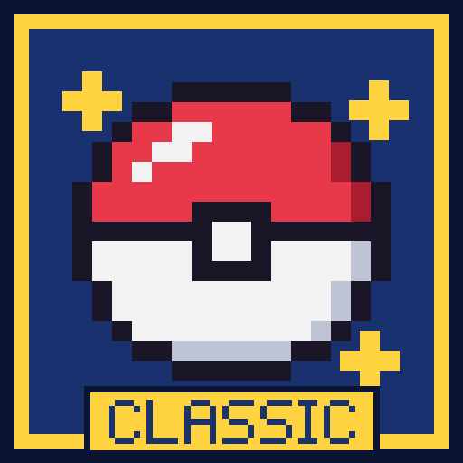
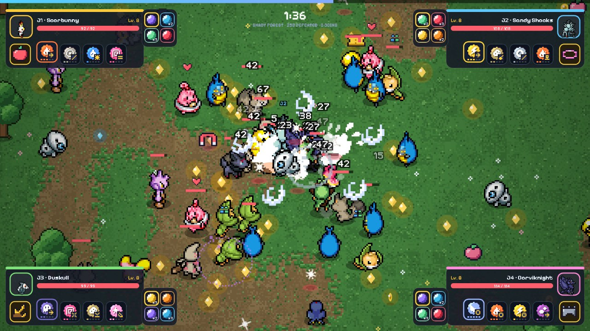
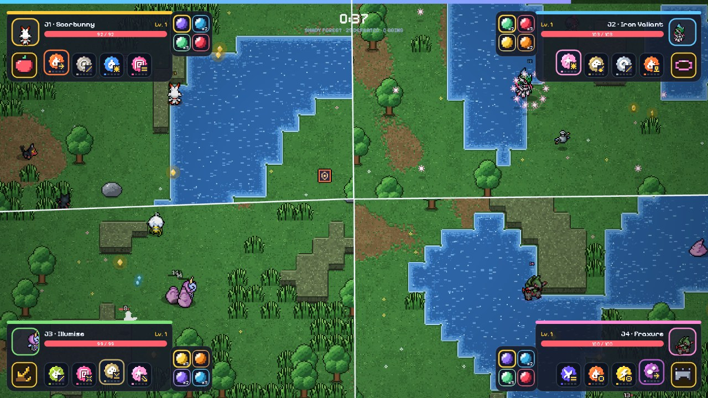
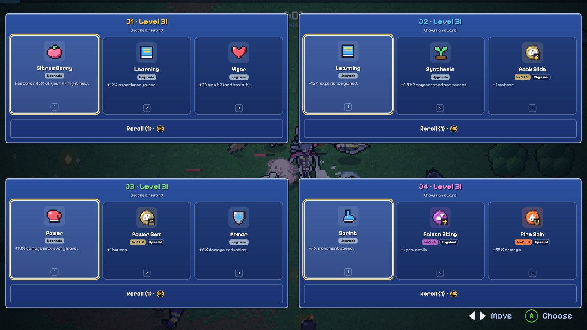

  

<h1 align="center">PokéSurvivor Classic Native</h1>

  <a href="https://devveda.github.io/pokesurvivor-classic-native/"><b>Play in the browser</b></a> ·
  <a href="https://github.com/DevVeda/pokesurvivor-classic-native/releases/latest"><b>Downloads</b></a> ·
  

<a href="#english">English</a> · <a href="#español">Español</a>

---

## English

A fork of [PokéSurvivor](https://pokesurvivor.com), the Pokémon bullet-heaven by **Jonathan Piera Torregrosa
(JPTER78)**, brought to more platforms from a single codebase: **web, Windows, macOS, Linux (and Steam Deck),
Android, Nintendo Switch and PS5**. A fan project: free and non-commercial.

> **Game authorship**
>
> The original game (its code and music) is written and owned by **Jonathan Piera Torregrosa (JPTER78)**, owner
> of pokesurvivor.com. This fork is **not** the official site and is not made by him.

> **No crypto**: neither this fork nor the game has any coin, token or NFT. Anything using the name belongs to
> third parties.

**Support:** the game is and will stay free, with no ads or purchases. If you want to help pay for the servers,
you can donate on [Ko-fi](https://ko-fi.com/DevVeda).

### Play

- **Browser:** <https://devveda.github.io/pokesurvivor-classic-native/>
- **Linux (AppImage, also Steam Deck), Windows and Android (APK):** from the
  [latest release](https://github.com/DevVeda/pokesurvivor-classic-native/releases/latest).
- **macOS, Switch and PS5:** build them yourself (below).

### Couch co-op

Up to 4 players on one screen, each with their own controller. Together, the camera follows everyone; when you split up,
the screen splits too. On level-up, each player picks a card in their own part of the screen.

  
  

### What this fork adds

- **The same screens on every platform** (`native/shim/ui.js`), made for controller, keyboard, mouse and touch;
  the web uses them too.
- **The run simulated in C** (`native/core/`), also on the web (WebAssembly), with **local co-op** for up to 4
  players on one screen.
- **Native versions** with QuickJS, PlutoVG and SDL2 (`native/`): GPU (OpenGL, Vulkan on PS5), its own audio,
  networking (Firebase over HTTPS and WebSocket) and online co-op over WebRTC.
- **Signed updates** (Ed25519) for the native versions.
- **Your own server**: anyone can run one (Firebase on the free plan) and players can switch servers and take
  their save with them.

### Building

You need [just](https://github.com/casey/just), Node.js and Docker (for Linux, Windows, Android and Switch).
Copy `env.example` to `.env` and fill in your server's values (never commit `.env`).

| Command | What it does |
|---|---|
| `just web-local` | The web version at `http://localhost:8124` |
| `just run` | The desktop game with the repository's files |
| `just macos` · `just linux` · `just windows` | Desktop packages |
| `just android` · `just switch` · `just ps5 <IP>` | Mobile and console packages |
| `just test` | The screen harness and the shim tests |
| `just check` | Builds every platform and runs the tests |

The console versions are homebrew: they need a console set up for it. This repository **does not include** keys,
firmware or anything from Sony or Nintendo: everyone provides their own (below), and none of it goes into git.

#### What each platform needs

For all of them: `.env` (from `env.example`) and, once, `just deps` (downloads the Firebase SDK, QuickJS and
libdatachannel).

| Platform | What you need | Where it goes |
|---|---|---|
| Web | Nothing else | — |
| macOS | `brew install sdl2 openssl@3 curl` | — |
| Linux, Windows | Docker (built in containers) | — |
| Android | Docker. A signing key: it is created the first time | `native/android/pokesurvivor.keystore`, with the password in `ANDROID_KS_PASS` (without it, `pokesurvivor`). **Keep it safe**: with a different key, the APK won't install over the previous one |
| Switch (`.nro`) | Docker (devkitPro is in the image) | — |
| Switch (`.nsp`, `just switch-nsp`) | **Your own console's** `prod.keys` (dumped with Lockpick_RCM) | `native/switch/prod.keys` (or `just switch-nsp keys=<path>`) |
| PS5 (title, `just ps5`) | [PS5_Vulkan](https://github.com/mihawk-99/PS5_Vulkan) cloned and built (its `tools/bootstrap`), and Docker | `../ps5gpu/PS5_Vulkan`, next to this repository (or the path in `PS5GPU`). The title ends up in `../ps5gpu/poke-title/dist` and packaged in `native/build/dist/ps5/PokeSurvivor-<version>-ps5.zip` (unzip it into `/data/homebrew/`); `just ps5 <IP>` uploads it over FTP (port 2121) with the game closed on the console |
| PS5 (payload, `just payload <IP>`) | The [ps5-payload-dev](https://github.com/ps5-payload-dev) SDK and LLVM 18 (`brew install llvm@18`) | `~/ps5-payload-dev/opt/ps5-payload-sdk` (or `PS5_PAYLOAD_SDK`) |

Your private files (`.env`, `*.keys`, `*.keystore`) are already in `.gitignore`.

### Controls

| Keyboard | Controller | Action |
|---|---|---|
| `W` `A` `S` `D` / arrows | Stick / D-pad | Move |
| `1`–`4`, `Q` / `E` | L / R | Pick or switch move |
| `Esc` / `P` | Start / Options | Pause |
| `Enter` / `Esc` | ✕ / ○ (A / B) | Confirm / back |

With your finger: drag anywhere to move, and tap the attacks or the pause button.

### Licenses

- **The game** (`js/`, `css/`, `index.html`, `tools/` and the music): © JPTER78, under
  [PolyForm Noncommercial 1.0.0](LICENSE-NONCOMMERCIAL.md) (versions up to commit `b297089`: MIT).
  You may use, study, modify and share it **for non-commercial purposes**. See [LICENSE](LICENSE).
  `Required Notice: Copyright 2026 JPTER78 (https://github.com/JPTER78/pokesurvivor)`
- **The native engine** (`native/`): GPL-3.0-or-later ([native/LICENSE](native/LICENSE),
  [native/NOTICE.md](native/NOTICE.md)), with an additional permission to distribute it together with the game
  without the game becoming GPL ([native/LICENSE-EXCEPTION.md](native/LICENSE-EXCEPTION.md)). It loads the game
  as data, like a browser.
- **Sprites**: [SpriteCollab](https://github.com/PMDCollab/SpriteCollab), CC BY-NC 4.0; artists in
  [CREDITS.md](CREDITS.md). Pixelify Sans font (OFL).
- **Pokémon** is owned by Nintendo, Creatures Inc. and GAME FREAK. This project is not affiliated with,
  sponsored or endorsed by them.

### Contributing

See [CONTRIBUTING.md](CONTRIBUTING.md), [CODE_OF_CONDUCT.md](CODE_OF_CONDUCT.md) and, for security issues,
[SECURITY.md](SECURITY.md).

---

## Español

Fork de [PokéSurvivor](https://pokesurvivor.com), el bullet-heaven con Pokémon de **Jonathan Piera Torregrosa
(JPTER78)**, llevado a más plataformas con un solo código: **web, Windows, macOS, Linux (y Steam Deck),
Android, Nintendo Switch y PS5**. Proyecto de fan, gratis y sin ánimo de lucro.

> **Autoría del juego**
>
> El juego original (su código y su música) lo escribió y es de **Jonathan Piera Torregrosa (JPTER78)**, dueño de
> pokesurvivor.com. Este fork **no es la web oficial** ni está hecho por él.

> **Sin criptomonedas**: ni este fork ni el juego tienen criptomoneda, token ni NFT. Cualquiera que use el
> nombre es de terceros.

**Apoyar:** el juego es y será gratis, sin anuncios ni compras. Si quieres ayudar a pagar los servidores, puedes
donar en [Ko-fi](https://ko-fi.com/DevVeda).

### Jugar

- **En el navegador:** <https://devveda.github.io/pokesurvivor-classic-native/>
- **Linux (AppImage, también Steam Deck), Windows y Android (APK):** en la
  [última versión](https://github.com/DevVeda/pokesurvivor-classic-native/releases/latest).
- **macOS, Switch y PS5:** se compilan (abajo).

### Cooperativo local

Hasta 4 jugadores en la misma pantalla, cada uno con su mando. Juntos, la cámara sigue a todos; si os separáis, la
pantalla se parte. Al subir de nivel, cada uno elige su carta en su parte de la pantalla.

  
  

### Qué añade este fork

- **Las mismas pantallas en todas las plataformas** (`native/shim/ui.js`), pensadas para mando, teclado,
  ratón y dedo; la web también las usa.
- **La partida simulada en C** (`native/core/`), también en la web (WebAssembly), con **cooperativo local**
  de hasta 4 jugadores en la misma pantalla.
- **Versiones nativas** con QuickJS, PlutoVG y SDL2 (`native/`): GPU (OpenGL / Vulkan en PS5), audio propio,
  red (Firebase por HTTPS y WebSocket) y cooperativo online por WebRTC.
- **Actualizaciones firmadas** (Ed25519) para las versiones nativas.
- **Servidor propio**: cualquiera puede montar el suyo (Firebase en plan gratuito) y el jugador puede cambiar
  de servidor y llevarse su partida.

### Compilar

Hace falta [just](https://github.com/casey/just), Node.js y Docker (para Linux, Windows, Android y Switch).
Copia `env.example` a `.env` y rellénalo con los datos de tu servidor (nunca subas `.env`).

| Comando | Qué hace |
|---|---|
| `just web-local` | La web, en `http://localhost:8124` |
| `just run` | El juego de escritorio con los archivos del repositorio |
| `just macos` · `just linux` · `just windows` | Paquetes de escritorio |
| `just android` · `just switch` · `just ps5 <IP>` | Paquetes de móvil y consolas |
| `just test` | El arnés de las pantallas y las pruebas de los shims |
| `just check` | Compila todas las plataformas y pasa las pruebas |

Las versiones de consola son homebrew: necesitan una consola preparada para ello. Este repositorio **no
incluye** claves, firmware ni nada de Sony o Nintendo: cada uno pone lo suyo (abajo) y nada de eso se sube a git.

#### Qué necesita cada plataforma

Para todas: `.env` (desde `env.example`) y, una vez, `just deps` (baja el SDK de Firebase, QuickJS y libdatachannel).

| Plataforma | Qué hace falta | Dónde va |
|---|---|---|
| Web | Nada más | — |
| macOS | `brew install sdl2 openssl@3 curl` | — |
| Linux, Windows | Docker (se compilan en contenedores) | — |
| Android | Docker. Una clave de firma: la primera vez se crea sola | `native/android/pokesurvivor.keystore`, con la contraseña de `ANDROID_KS_PASS` (sin ella, `pokesurvivor`). **Guárdala**: con otra clave, el APK no se instala encima del anterior |
| Switch (`.nro`) | Docker (devkitPro va en la imagen) | — |
| Switch (`.nsp`, `just switch-nsp`) | Las `prod.keys` **de tu consola** (se sacan con Lockpick_RCM) | `native/switch/prod.keys` (o `just switch-nsp keys=<ruta>`) |
| PS5 (título, `just ps5`) | [PS5_Vulkan](https://github.com/mihawk-99/PS5_Vulkan) clonado y compilado (su `tools/bootstrap`), y Docker | `../ps5gpu/PS5_Vulkan`, al lado de este repositorio (o la ruta en `PS5GPU`). El título sale en `../ps5gpu/poke-title/dist` y empaquetado en `native/build/dist/ps5/PokeSurvivor-<versión>-ps5.zip` (se descomprime en `/data/homebrew/`); `just ps5 <IP>` lo sube por FTP (puerto 2121) con el juego cerrado en la consola |
| PS5 (payload, `just payload <IP>`) | El SDK de [ps5-payload-dev](https://github.com/ps5-payload-dev) y LLVM 18 (`brew install llvm@18`) | `~/ps5-payload-dev/opt/ps5-payload-sdk` (o `PS5_PAYLOAD_SDK`) |

Lo que es tuyo y privado (`.env`, `*.keys`, `*.keystore`) ya está en `.gitignore`.

### Controles

| Teclado | Mando | Acción |
|---|---|---|
| `W` `A` `S` `D` / flechas | Stick / cruceta | Moverse |
| `1`–`4`, `Q` / `E` | L / R | Elegir o cambiar de movimiento |
| `Esc` / `P` | Start / Options | Pausa |
| `Enter` / `Esc` | ✕ / ○ (A / B) | Confirmar / volver |

Con el dedo: arrastra en cualquier sitio para moverte y toca los ataques o la pausa.

### Licencias

- **El juego** (`js/`, `css/`, `index.html`, `tools/` y la música): © JPTER78, bajo
  [PolyForm Noncommercial 1.0.0](LICENSE-NONCOMMERCIAL.md) (las versiones hasta el commit `b297089`, MIT).
  Se puede usar, estudiar, modificar y compartir **sin fines comerciales**. Ver [LICENSE](LICENSE).
  `Required Notice: Copyright 2026 JPTER78 (https://github.com/JPTER78/pokesurvivor)`
- **El motor nativo** (`native/`): GPL-3.0-or-later ([native/LICENSE](native/LICENSE),
  [native/NOTICE.md](native/NOTICE.md)), con un permiso adicional para distribuirlo junto al juego sin que el juego
  pase a ser GPL ([native/LICENSE-EXCEPTION.md](native/LICENSE-EXCEPTION.md)). Carga el juego como datos, igual que un navegador.
- **Sprites**: [SpriteCollab](https://github.com/PMDCollab/SpriteCollab), CC BY-NC 4.0; artistas en
  [CREDITS.md](CREDITS.md). Fuente Pixelify Sans (OFL).
- **Pokémon** es propiedad de Nintendo, Creatures Inc. y GAME FREAK. Este proyecto no está afiliado,
  patrocinado ni aprobado por ellos.

### Contribuir

Ver [CONTRIBUTING.md](CONTRIBUTING.md), [CODE_OF_CONDUCT.md](CODE_OF_CONDUCT.md) y, para fallos de
seguridad, [SECURITY.md](SECURITY.md).
